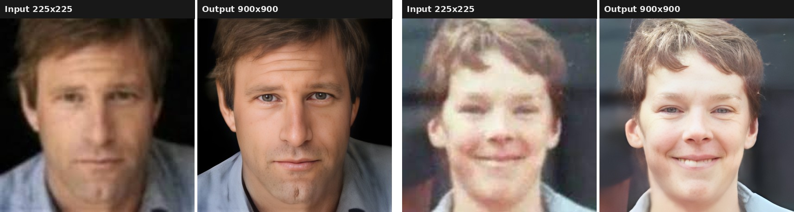
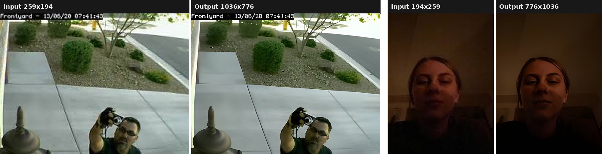

# Snapshot Enhancement with Real-ESRGAN


An evaluation of [Real-ESRGAN](https://github.com/xinntao/Real-ESRGAN) as an image enhancement
step for a smart home security system: when a door access attempt is rejected or flagged as a
spoof, the saved snapshot is often small, blurry or heavily compressed. This project tests how much
detail super-resolution can recover from such snapshots, and what it costs in time and memory.



## Table of contents

- [Goal](#goal)
- [Results](#results)
- [Time and memory](#time-and-memory)
- [Tech stack](#tech-stack)
- [Project structure](#project-structure)
- [Installation](#installation)
- [Usage](#usage)
- [Limitations](#limitations)
- [Related projects](#related-projects)
- [Acknowledgements](#acknowledgements)
- [License](#license)

## Goal

The [face recognition door access module](https://github.com/Abdulkarem-SHAHEN/anti-spoofing-face-recognition)
stores a snapshot of every access attempt. For the attempts that matter most — failed recognition
and detected spoofing — the homeowner wants to see who was at the door, but the frame may come from
a low-resolution camera, or from someone standing far away or hiding their features.

Two questions were tested:

1. Does a pretrained super-resolution model make these snapshots easier to inspect?
2. Is it light enough to run on the same machine as the rest of the system?

No model was trained here. The project uses the pretrained `RealESRGAN_x4plus` weights and
measures their behaviour on this use case.

## Results

All samples are upscaled ×4. Inputs are in [`samples/`](samples) and outputs in
[`results/`](results).

**Low-resolution faces** (225×225 → 900×900) — shown at the top of this page. Facial features that
are a blur in the input become clearly readable.

**Camera-style scenes** (about 259×194 → 1036×776):



What the samples show:

- **Resolution and compression artefacts** are where the model helps most: edges, hair, eyes and
  clothing become sharp.
- **Darkness is not corrected.** In the low-light sample the output is sharper but just as dark.
  Super-resolution adds detail, it does not add light.
- **Small text is redrawn, not read.** In the doorbell sample the camera overlay `Frontyard` comes
  out with altered letters and a date digit changes. Fine details in the output are the model's
  best guess.

## Time and memory

Measured with [`src/enhance.py`](src/enhance.py), which records the processing time and the peak
resident memory (RSS) of the process for each image. Each row is a separate run on a **CPU-only
machine with 2 vCPUs (Intel Xeon 2.8 GHz) and 7 GB of RAM**, with a portrait photo resized to
the input size.

| Input | Output (×4) | Mode | Time | Peak RAM |
|---|---|---|---|---|
| 216×288 | 864×1152 | Real-ESRGAN | 16.4 s | 1.3 GB |
| 216×288 | 864×1152 | Real-ESRGAN + GFPGAN | 23.6 s | 2.2 GB |
| 360×480 | 1440×1920 | Real-ESRGAN | 56.9 s | 2.7 GB |
| 360×480 | 1440×1920 | Real-ESRGAN + GFPGAN | 63.6 s | 3.5 GB |
| 480×640 | 1920×2560 | Real-ESRGAN | 105.6 s | 4.5 GB |
| 480×640 | 1920×2560 | Real-ESRGAN + GFPGAN | 109.6 s | 5.3 GB |
| 480×640 | 1920×2560 | Real-ESRGAN, `--tile 200` | 98.5 s | 1.3 GB |

Takeaways:

- **Memory grows with the input area.** Going from 216×288 to 480×640 multiplies the pixel count
  by about 5 and peak memory by about 3.3.
- **Tiling removes the memory problem.** Processing the 480×640 image in 200-pixel tiles cuts peak
  memory from 4.5 GB to 1.3 GB with no time penalty.
- **Face restoration costs about 0.8 GB more**, the size of the extra GFPGAN and face detection
  models.
- **On CPU this is an offline step.** At 16 seconds or more per snapshot it fits a background job
  that runs after a rejected attempt, not the live recognition loop. Cropping the face region
  before enhancement keeps both time and memory at the low end of the table.

## Tech stack

| Component | Technology |
|---|---|
| Super-resolution | [Real-ESRGAN](https://github.com/xinntao/Real-ESRGAN) `RealESRGAN_x4plus` (RRDBNet, 23 blocks) |
| Face restoration (optional) | [GFPGAN](https://github.com/TencentARC/GFPGAN) v1.3 |
| Framework | PyTorch 1.13, BasicSR 1.4.2 |
| Image I/O | OpenCV |
| Memory measurement | psutil |
| Language | Python 3.10 |

## Project structure

```
realesrgan-snapshot-enhancement/
├── src/
│   └── enhance.py        # enhancement + time and peak-memory measurement
├── samples/              # low-quality input images
├── results/              # enhanced outputs of the samples
├── assets/               # figures used in this README
├── weights/              # model weights, downloaded on first run
├── requirements.txt
├── LICENSE
└── README.md
```

## Installation

Use **Python 3.10**. BasicSR 1.4.2 does not work with recent torchvision releases, so the versions
in `requirements.txt` are pinned.

```bash
git clone https://github.com/Abdulkarem-SHAHEN/realesrgan-snapshot-enhancement.git
cd realesrgan-snapshot-enhancement

python -m venv venv
venv\Scripts\activate            # Windows
# source venv/bin/activate       # Linux / macOS

pip install -r requirements.txt
```

The model weights are downloaded into `weights/` the first time the script runs
(`RealESRGAN_x4plus.pth`, 64 MB, and `GFPGANv1.3.pth`, 333 MB, only if face enhancement is used).

## Usage

Run from the repository root.

```bash
# enhance every image in a folder (x4)
python src/enhance.py samples

# a single image, with face restoration and a before/after comparison image
python src/enhance.py samples/face_01.jpeg --face-enhance --side-by-side

# large image on a machine with little memory
python src/enhance.py path/to/image.jpg --tile 200
```

| Option | Default | Meaning |
|---|---|---|
| `input` | — | Image file or folder of images |
| `-o`, `--output` | `results/` | Output folder |
| `-s`, `--outscale` | `4` | Final upscaling factor |
| `--face-enhance` | off | Restore faces with GFPGAN |
| `--tile` | `0` | Tile size in pixels; `0` processes the whole image at once |
| `--side-by-side` | off | Also save `<name>_compare.jpg` with input and output next to each other |

For every image the script saves `<name>_out.png`, prints one line with the sizes, the time and the
peak memory, and writes the same figures to `results/benchmark.csv`:

```
snapshot_216x288.jpg            216x288 ->   864x1152    16.42 s    1344 MB peak
```

A GPU is used automatically when PyTorch can see one.

## Limitations

- **Enhanced faces are not evidence of identity.** Real-ESRGAN, and GFPGAN even more, generate
  plausible detail that was not captured by the camera. The output helps a person look at a
  snapshot; it must not be fed to face recognition or used to identify someone.
- **Low light is not fixed.** A dark snapshot needs exposure or low-light enhancement first.
- **Text and small patterns can change**, as the doorbell sample shows.
- **CPU inference is slow** and memory grows quickly with image size unless tiling is used.
- This is an evaluation with a handful of samples, not a quantitative study: no PSNR, SSIM or
  recognition-accuracy figures were computed.

## Related projects

- [anti-spoofing-face-recognition](https://github.com/Abdulkarem-SHAHEN/anti-spoofing-face-recognition)
  — the door access module whose snapshots this step is meant to enhance.
- [bilingual-rag-assistant](https://github.com/Abdulkarem-SHAHEN/bilingual-rag-assistant) — the
  support assistant of the same smart home system.

## Acknowledgements

- [Real-ESRGAN](https://github.com/xinntao/Real-ESRGAN) by Xintao Wang et al. (BSD 3-Clause).
- [GFPGAN](https://github.com/TencentARC/GFPGAN) by Tencent ARC (Apache 2.0).

The sample images are used for demonstration only and belong to their respective owners.

## License

The code in this repository is released under the [MIT License](LICENSE). The pretrained models
keep the licenses of their authors.
